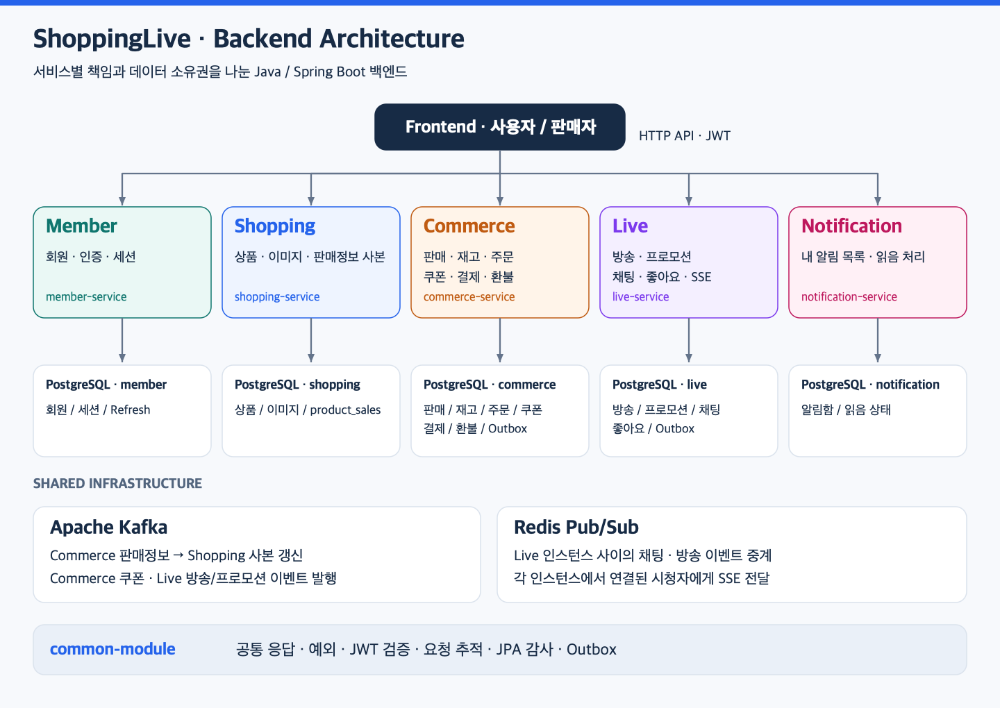
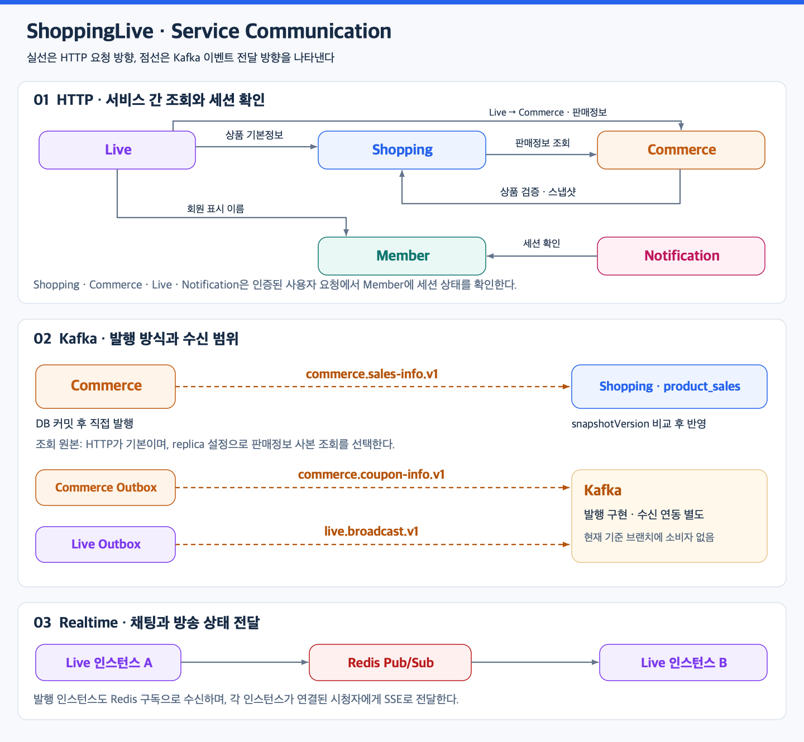

# ShoppingLive

**방송 시청부터 상품 구매까지 연결하는 라이브 커머스 백엔드**

판매자는 상품과 판매정보를 등록하고 방송에 상품을 연결합니다. 사용자는 방송을 보며 채팅과 좋아요로 참여하고, 상품을 장바구니에 담아 쿠폰을 적용해 주문·결제할 수 있습니다.

회원, 상품, 거래, 방송, 알림의 책임을 5개 Spring Boot 서비스로 나눴습니다. 서비스별 데이터를 PostgreSQL의 독립된 데이터베이스에 저장하며, 필요한 조회는 HTTP로 요청하고 변경 정보는 Kafka 이벤트로 전달합니다.

## 아키텍처

각 서비스는 자신의 데이터를 소유하고 API와 이벤트로 협력합니다. 상품의 기본정보·이미지는 Shopping이, 가격·재고·주문·결제는 Commerce가 담당합니다. 공통 응답, 인증 검증, 요청 추적, JPA 감사와 Outbox 구현은 `common-module`에서 공유합니다.

## 서비스 간 통신

| 방식 | 주요 흐름 |
|---|---|
| HTTP | Commerce → Shopping 상품 검증, Shopping → Commerce 판매정보 조회, Live → Shopping·Commerce 방송 상품 조회, Live → Member 회원 표시 이름 조회 |
| 인증 확인 | Shopping·Commerce·Live·Notification → Member 세션 활성 상태 확인 |
| Kafka | Commerce 판매정보 → Shopping 조회용 사본 갱신. 쿠폰과 방송·프로모션 이벤트는 Outbox를 통해 발행 |
| Redis Pub/Sub + SSE | Live 인스턴스 사이에서 채팅·방송 상태를 중계하고 시청자 연결에 실시간 전달 |

판매정보 조회는 이벤트로 채운 사본(`replica`)이 기본이며 `shopping.sales.source=http`(`SHOPPING_SALES_SOURCE=http`)로 Commerce 직접 조회로 되돌릴 수 있습니다. 판매정보 이벤트는 DB 커밋 후 직접 발행하고, 쿠폰·방송·프로모션 이벤트는 상태 변경과 Outbox 기록을 같은 트랜잭션으로 묶습니다. 쿠폰·방송 이벤트의 소비 연동은 별도 작업입니다.

## 주요 기능

| 서비스 | 책임 | 구현된 기능 |
|---|---|---|
| [Member](services/member-service) | 회원·인증·세션 | 회원가입, 로그인, JWT 발급, Refresh Token 교체, 로그아웃, 회원정보 수정·탈퇴, 세션 폐기·확인 |
| [Shopping](services/shopping-service) | 상품 기본정보·이미지 | 상품 등록·수정, 공개·판매자 상품 조회, 이미지 업로드·조회, 서비스용 상품 스냅샷, 판매정보 이벤트 수신·사본 저장 |
| [Commerce](services/commerce-service) | 판매·재고·거래 | 판매·재고 관리, 장바구니, 단건·여러 상품 주문, 결제 묶음, 정액 쿠폰 생성·수령·예약·사용, 주문 취소, 결제·환불 및 결과 재확인 |
| [Live](services/live-service) | 방송·실시간 참여 | 방송 등록·시작·종료, 방송 상품 연결·정렬, 프로모션 생성·열기·닫기, 채팅, 회원별 좋아요, SSE |
| [Notification](services/notification-service) | 내 알림함 | 커서 기반 알림 목록, 안 읽은 알림 개수, 본인 알림 읽음 처리 |

결제·환불은 현재 Mock 제공자로 구현되어 있습니다. Live는 로컬 IVS stub과 AWS IVS 조회 어댑터를 제공하며, 실제 PG·방송 플랫폼의 운영 연동과는 구분합니다. Notification은 알림함 API를 제공하고 이벤트 수신을 통한 알림 생성은 별도 작업입니다.

## 기술 스택

| 구분 | 기술 | 사용 목적 |
|---|---|---|
| 언어·프레임워크 | Java 21, Spring Boot 3.5, Spring MVC | 도메인별 HTTP API와 애플리케이션 구성 |
| 데이터 | PostgreSQL 16, Spring Data JPA, JDBC | 업무 상태 저장, 잠금과 조건부 갱신 |
| 스키마 | Flyway | 서비스별 데이터베이스 마이그레이션 |
| 인증 | Spring Security, JWT | 사용자 인증·권한과 서비스 간 접근 제어 |
| 메시징 | Apache Kafka | 판매정보·쿠폰·방송 이벤트 발행과 판매정보 수신 |
| 실시간 통신 | Redis Pub/Sub, SSE | Live 인스턴스 간 이벤트 중계와 시청자 전달 |
| 외부 호출 | RestClient, Resilience4j | 서비스 간 조회, 선택적 재시도·회로 차단 |
| 계약·문서 | OpenAPI, AsyncAPI | API·이벤트 계약 관리 |
| 빌드·검증 | Gradle 멀티 모듈, JUnit 5, H2, Spotless, GitHub Actions | 빌드, 테스트, 포맷 검사와 CI |
| 개발 인프라 | Docker Compose, Kubernetes 개발 매니페스트 | PostgreSQL·Redis·Kafka와 서비스 실행 구성 |

## 주요 설계

### 재시도와 동시 요청을 고려한 주문·재고 처리

주문 생성은 회원과 멱등 키로 기존 주문을 찾아 재요청을 처리합니다. 재고 예약은 `available >= quantity` 조건이 있는 UPDATE로 수행하고, 결제 성공·취소·만료에 따라 예약 재고를 소진하거나 복구합니다. 여러 상품 주문은 상품별 주문과 결제 묶음을 함께 관리합니다.

### 결제·환불의 불확실한 결과 재확인

결제·환불 요청과 결과를 저장하고, 결과가 확정되지 않은 경우 재확인 작업으로 후속 상태를 결정합니다. 환불 접수와 실행·결과 반영을 분리하며, 주문·재고·쿠폰 상태도 처리 결과에 맞춰 갱신합니다.

### JWT와 서버 세션 상태를 함께 확인하는 인증

각 서비스가 JWT 서명을 검증한 뒤 Member에 세션 활성 상태를 확인합니다. 로그아웃·세션 폐기 이후의 토큰 사용을 차단하며, 내부 API는 호출 서비스별 `X-Service-Token`으로 구분합니다.

### 조회용 사본과 이벤트 발행 경계

Shopping은 판매정보를 조회용 사본에 저장하며 더 큰 `snapshotVersion`만 반영해 중복·역순 이벤트가 최신 값을 덮지 않게 합니다. 쿠폰·방송·프로모션 이벤트는 공통 Outbox 릴레이로 발행하고, 판매정보의 커밋 후 직접 발행과는 전달 방식을 구분합니다.

### 여러 Live 인스턴스에서 실시간 이벤트 전달

채팅과 방송 종료 이벤트를 Redis Pub/Sub으로 중계하고 각 Live 인스턴스가 자신에게 연결된 시청자에게 SSE로 전달합니다. 채팅 내역과 좋아요 상태는 PostgreSQL에 저장하며, 좋아요 합계는 주기적으로 변경분을 전달합니다.

## API · 문서

- [Backend 팀 하네스](harness/README.md): AI 작업 지침·검증 안내·이슈와 PR 작성 템플릿.

API 문서 원본은 [서비스별 OpenAPI YAML](contracts/api)입니다. Apidog·Postman에 서비스 YAML을 가져와 API를 확인하고 호출하거나, curl로 직접 요청합니다. YAML의 `servers`에 서비스별 로컬 주소가 정의되어 있습니다.

서비스 YAML이 `common.yaml`을 참조하므로 가져올 때 함께 제공하거나 도구의 외부 참조 해석 기능을 사용합니다. 인증이 필요한 API는 계약에 따라 `Authorization: Bearer <JWT>` 또는 `X-Service-Token` 헤더를 보냅니다.

- [이벤트 계약](contracts/events): Kafka 이벤트의 AsyncAPI YAML 원본.
- [Infra 저장소](https://github.com/2026-2-rising-sun/Infra): 로컬 미들웨어와 Kubernetes 개발 환경 구성.
- [팀 프로젝트 문서](https://app.notion.com/p/3e9226545d1581989a9edefd9da775c4): 기능명세·ERD·설계·협업 문서.
