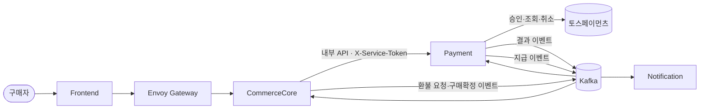
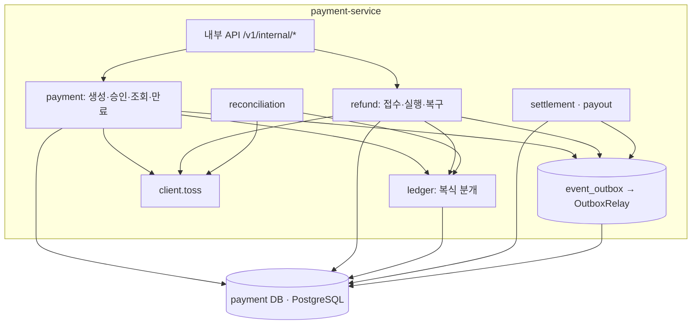

# 목표 설계와 작은 판단

결제 재설계의 **구현 전 목표**다. 현재 코드 설명은 [Payment 모듈 문서](../../../design-docs/services/payment/README.md)에 있고, PR이 병합될 때마다 해당 부분을 그쪽으로 옮긴다. 이 파일은 계획이 끝나면 계획 폴더와 함께 `completed/`로 간다. 표의 `#앵커`는 [이벤트 스토밍 v41](event-storming-v41.html)의 절이다.

## 컨텍스트 (C4 L1)

## 컨테이너 (C4 L2, Payment 내부)

## 패키지

`com.shoppinglive.payment.<도메인>.{controller,service,repository,entity,dto}` ([코드 기준](../../../guides/code.md)). 외부 클라이언트는 `client.toss`.

| 도메인 패키지 | 마일스톤 | 테이블(원본 `#ddl`) |
|---|---|---|
| `payment` | M1 | payment, payment_seller_amount, pg_call |
| `ledger` | M1 | ledger_journal, ledger_entry |
| `client.toss` | M1 | — |
| `refund` | M2 | refund, refund_item |
| `reconciliation` | M3 | reconciliation_run, reconciliation_mismatch |
| `settlement`, `payout` | M4, M5 | settlement_item, payout, seller_payout_account |

기존 루트 패키지(`controller`, `service`, `entity`, …)는 M1 PR0에서 지운다.

## 공통 규칙

| 주제 | 규칙 | 근거 |
|---|---|---|
| 금액 | 원 단위 BIGINT. 수수료 `floor(판매 금액 × 율)`. 환불 수수료 = floor(환불 전 잔액 × 율) − floor(환불 후 잔액 × 율) | `#f9`, `#f10` |
| 상태 변경 | 이전 상태 조건부 UPDATE. 영향 행 0이면 다시 읽어 판단 | `#states` |
| 외부 호출 | 트랜잭션 밖에서. 호출 전 상태(APPROVING)와 호출 기록(pg_call)을 먼저 커밋 | `#f2`, `#f4` |
| 이벤트 | 상태 변경과 같은 트랜잭션에서 `EventOutbox`에 쓴다(common-module). 받는 쪽은 업무 키 UNIQUE + `ON CONFLICT DO NOTHING` | `#contract` |
| 멱등 | 결제 생성 = orderRef, 토스 승인 = `confirm-{pg_order_id}`, 환불 = refund_request_id | `#api`, `#toss` |
| 시간 | 판단은 DB `now()`. 타임아웃: 토스 읽기 60초, 승인 응답 대기 8초 → 202 | `#api` 응답 시간 예산 |
| 원장 | 상태 변경과 같은 트랜잭션에서 분개. 분개 하나의 차변 합 = 대변 합 | `#f9` |
| 응답 | common-module `ApiResponse`. 인증 `X-Service-Token` | `#api` |

## 작은 판단

ADR로 올리기엔 작은 결정이다. 바뀌면 이 표를 고친다.

| 판단 | 이유 | 감수 |
|---|---|---|
| 원본에 없는 오류 코드 `STALE_CHECKOUT`, `PG_UNAVAILABLE`, `PAYMENT_BUSY`를 쓴다 | 예전 결제창·연결 실패·풀 포화를 Commerce가 구분해 안내해야 한다 | 이벤트 스토밍 v41과 다르다. 계약 YAML이 원본이 된다 |
| 승인 응답 검증 실패 뒤 보상 취소가 불명이어도 결제는 CANCELED | 정상이면 생기지 않는 일이다. 상태를 늘리지 않는다 | 돈이 잡힌 채 CANCELED일 수 있다. M3 거래 대사 전까지는 오류 로그로 수동 확인 |
| 토스 401·403·429는 "보내지 않음"(CREATED 유지, 503)으로 본다 | 우리 키 설정 문제나 호출 제한은 카드 거절이 아니다. 돈이 움직이지 않은 응답이다 | 원본 `#f4`는 4xx를 모두 거절로 본다 |
| 보상 취소 멱등 키 `cancel-{pg_order_id}`, 승인 조회는 orderId의 마지막 `-` 앞부분으로 결제를 찾는다 | 원본에 값이 없다 | — |
| 스케줄러에 분산 락을 두지 않는다 | 모든 전이가 이전 상태 조건부 UPDATE라 중복 실행이 무해하다 | 같은 결제를 두 인스턴스가 조회할 수 있다(토스 조회 1번 더) |
| 원본 V7(정산·지급)을 V7 정산, V8 지급으로 나눈다 | 마일스톤이 다르다 | M4 착수 때 확인 |
| UNKNOWN 조회 간격 10초·30초·1분·5분, 마감 30분 | 원본 `#f4` 제안값 | 운영 후 조정 |
